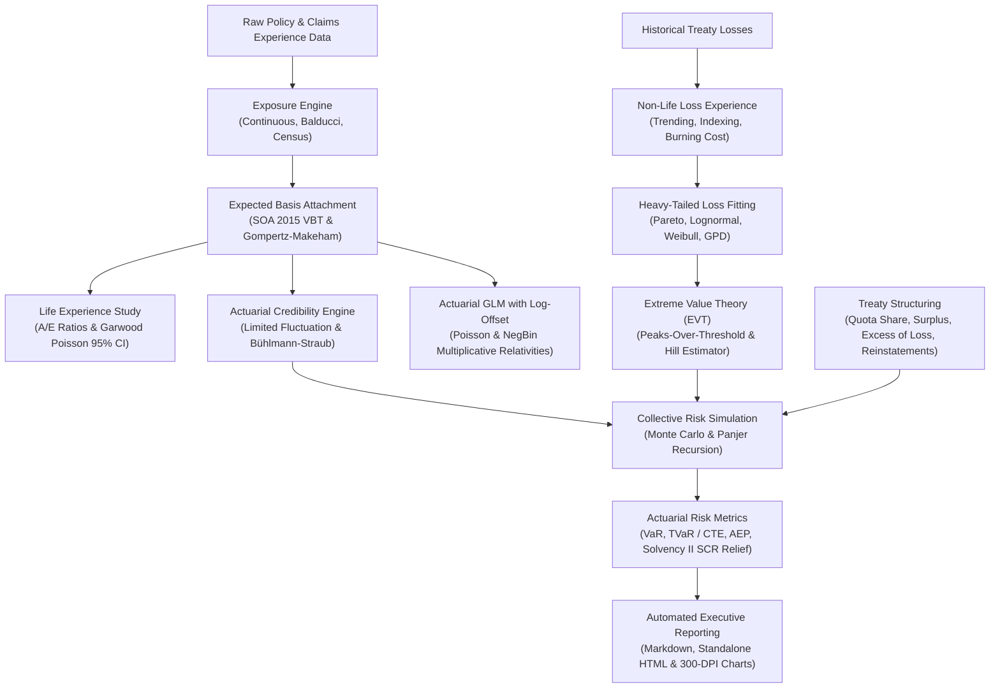

# Reinsurance Analytics: Actuarial Experience Analysis & Quantitative Risk Engine

[](https://github.com/deadmigue55/upgraded-pancake/actions/workflows/ci.yml)
[](https://www.python.org/)
[](https://opensource.org/licenses/MIT)
[](#)

A production-grade Python library and CLI for **Reinsurance Experience Analysis**, **Actuarial Credibility Theory**, **Extreme Value Theory (EVT)**, **Treaty Layering**, and **Stochastic Solvency Simulation**.

---

## 🏛️ System Architecture



---

## 📌 Core Capabilities

### 1. Longitudinal Exposure Calculation (`core.exposure`)
- Exact continuous (daily) exposure: $\frac{\min(T_{\text{end}}, T_{\text{exit}}) - \max(T_{\text{start}}, T_{\text{issue}})}{365.25}$.
- Classical Balducci annual exposure (extending death exposure to end of policy year).
- Census calendar year exposure and fractional policy-year segmentation.
- Split exposure by policy duration, attained age, gender, smoker status, underwriting class, and retention limit.
- Distinction between Count Exposure, Face Amount Exposure, and Ceded Exposure.

### 2. Actual-to-Expected ($A/E$) Experience Studies (`life.experience_study`)
- $A/E_{\text{count}}$ and $A/E_{\text{amount}}$ ratios.
- **Garwood exact Poisson confidence intervals** (SOA standard) using exact Chi-Square bounds:
  $$\text{CI}_{1-\alpha} = \left[ \frac{\chi^2_{2A, \, \alpha/2}}{2E}, \; \frac{\chi^2_{2(A+1), \, 1 - \alpha/2}}{2E} \right]$$
- Parametric Gompertz-Makeham laws and SOA 2015 Valuation Basic Table (VBT) select-and-ultimate benchmarks.
- Pearson Chi-Square goodness-of-fit testing across demographic cells.

### 3. Actuarial Credibility Theory (`core.credibility`)
- **Classical / Limited Fluctuation Credibility (American Credibility):**
  - Full credibility standard $n^* = \left(\frac{z_{1 - \alpha/2}}{k}\right)^2 (1 + CV^2)$.
  - Exact Poisson benchmark ($90\%$ probability within $5\%$): $n^* \approx 1,082$ claims.
  - Partial credibility: $Z = \min(1.0, \sqrt{n / n^*})$.
  - Credibility-adjusted basis: $A/E_{\text{cred}} = Z \cdot (A/E) + (1 - Z) \cdot 1.00$.
- **Bühlmann-Straub Nonparametric Empirical Bayes Credibility:**
  - Decomposes longitudinal multi-cedant experience into Expected Process Variance (EPV / $s^2$) and Variance of Hypothetical Means (VHM / $a$).
  - Group credibility factor: $Z_i = \frac{P_{i\cdot}}{P_{i\cdot} + s^2/a}$.

### 4. Actuarial GLMs & Survival Analysis (`life.glm_modeling`)
- Poisson and Negative Binomial Generalized Linear Models with $\log(\text{exposure})$ offset:
  $$\ln(\mathbb{E}[\text{Claims}]) = \ln(\text{Exposure}) + \beta_0 + \sum_{j} \beta_j X_j$$
- Multiplicative risk relativities ($\exp(\beta)$) with Wald confidence intervals and deviance statistics.
- Nonparametric Kaplan-Meier survival analysis with **Greenwood's variance formula** for policy survival and lapse curves.

### 5. Heavy-Tailed Loss Fitting & EVT (`nonlife.distributions`, `nonlife.extreme_value`)
- Truncated Maximum Likelihood Estimation (MLE) for Pareto Type I, Lomax, Lognormal, Weibull, and Generalized Pareto (GPD).
- Limited Expected Value (LEV) calculation: $\mathbb{E}[X \wedge u] = \int_0^u (1 - F(x)) dx$.
- Extreme Value Theory (EVT): Peaks-Over-Threshold (POT) and Hill estimator for heavy-tail index $\alpha = 1 / \xi$.
- Model selection via AIC, BIC, and Kolmogorov-Smirnov goodness-of-fit tests.

### 6. Treaty Structuring & Layering (`treaty.structures`, `treaty.layering`)
- **Quota Share:** Cession percentage, ceding commission, profit commission.
- **Surplus Treaty:** Line retentions, surplus cession fractions, maximum capacity.
- **Excess of Loss (Per Risk / Per Occurrence):** $L \text{ xs } A$ layering.
- **Reinstatements:** Pro-rata as to amount, pro-rata as to time and amount, free reinstatements.
- **Aggregate Stop Loss:** Attachment and limit over total annual portfolio losses.
- Cascading Multi-tier Reinsurance Towers (e.g., Working XL $\to$ Mezzanine XL $\to$ Catastrophe XL $\to$ Cedant Net).

### 7. Stochastic Simulation & Solvency II Capital Relief (`simulation`)
- Compound Collective Risk Model: $S = \sum_{i=1}^N X_i$ with Poisson / Negative Binomial frequency and fitted continuous severity.
- **Panjer Recursion Algorithm** for exact analytical compound distributions.
- Vectorized Monte Carlo simulation across thousands of annual portfolio realizations.
- Risk Metrics: Value-at-Risk ($\text{VaR}_{99.5\%}$), Tail Value-at-Risk ($\text{TVaR}_{99.5\%}$ / Expected Shortfall / CTE).
- Occurrence Exceedance Probability (OEP) and Aggregate Exceedance Probability (AEP) curves.
- Solvency II / NAIC RBC 1-in-200 year underwriting SCR Capital Relief calculation.

### 8. Publication-Quality Visualizations & Executive Reports (`reporting`)
- 300-DPI publication charts:
  - Mortality $A/E$ curve with 95% Poisson confidence error bars and exposure bars.
  - Kaplan-Meier survival curves with Greenwood confidence bands.
  - Gross vs Net Reinsurance Aggregate Exceedance Probability (AEP) curves.
  - Credibility convergence curves ($Z$ vs $n$).
- Automated Executive Experience Study Report generated in GitHub Flavored Markdown and standalone CSS-styled HTML.

---

## 🚀 Quickstart

### Installation

```bash
git clone https://github.com/deadmigue55/upgraded-pancake.git
cd upgraded-pancake
pip install -r requirements.txt
pip install -e .
```

### Running the End-to-End Analysis via CLI

Run the full actuarial analysis pipeline (synthesizes 15,000 policies, runs exposure tracking, $A/E$ study, GLMs, credibility, 10,000 Monte Carlo treaty trials, and generates reports and charts):

```bash
reinsurx full-analysis --policies 15000 --trials 10000 --output output
```

Or run directly with Python launcher:

```bash
py -m reinsurance_analytics.cli full-analysis
```

Outputs will be saved to:
- `output/figures/mortality_ae_experience.png`
- `output/figures/reinsurance_aep_curve.png`
- `output/figures/credibility_convergence.png`
- `output/reports/reinsurance_experience_report.md`
- `output/reports/reinsurance_experience_report.html`

---

## 💻 Python API Usage Examples

### 1. Life Experience Study & Garwood Poisson Confidence Intervals

```python
import pandas as pd
from reinsurance_analytics.core.exposure import ExposureEngine, ExposureMethod
from reinsurance_analytics.core.mortality_tables import SOAVBTBenchmark
from reinsurance_analytics.life.experience_study import LifeExperienceStudy

# 1. Calculate policy exposure
engine = ExposureEngine(study_start="2020-01-01", study_end="2024-12-31")
exposed_df = engine.process_portfolio(df)

# 2. Attach SOA Valuation Basic Table benchmark
benchmark = SOAVBTBenchmark()
modeled_df = benchmark.attach_expected_rates(exposed_df)

# 3. Conduct multi-dimensional A/E experience study
study = LifeExperienceStudy(confidence_level=0.95)
result = study.analyze(modeled_df, group_cols=["attained_age", "smoker"])

print(f"Overall A/E (Count): {result.ae_ratio_count * 100:.2f}%")
print(f"95% Poisson CI: [{result.ae_count_ci_lower*100:.2f}%, {result.ae_count_ci_upper*100:.2f}%]")
print(f"Credibility Factor Z: {result.overall_credibility_z:.3f}")
print(f"Credibility-Adjusted A/E: {result.credibility_adjusted_ae * 100:.2f}%")
```

### 2. Bühlmann-Straub Empirical Bayes Credibility

```python
from reinsurance_analytics.core.credibility import BuhlmannStraubCredibility

bs = BuhlmannStraubCredibility()
fit_results = bs.fit(cedant_panel_df, group_col="cedant_id", loss_ratio_col="loss_ratio", exposure_col="exposure")

print(f"EPV (s^2): {fit_results['epv_s2']:.6f}")
print(f"VHM (a):   {fit_results['vhm_a']:.6f}")
print(f"k* ratio:  {fit_results['buhlmann_constant_k']:.1f}")

# Predict credibility for a specific cedant
prediction = bs.predict_group(exposure=12500, observed_mean=0.68)
print(f"Cedant Credibility Z: {prediction.credibility_factor:.3f}")
print(f"Credibility Estimate: {prediction.credibility_weighted_estimate:.4f}")
```

### 3. Excess of Loss Treaty Layering & Reinstatements

```python
from reinsurance_analytics.treaty.structures import ExcessOfLossTreaty, ReinsuranceProgram
from reinsurance_analytics.treaty.reinstatements import ReinstatementClause, ReinstatementType

# Define 2 reinstatements at 100% rate
clause = ReinstatementClause(count=2, rate=1.0, reinstatement_type=ReinstatementType.PRO_RATA_AMOUNT)

# Structure Excess of Loss layer: $5M xs $2M
layer = ExcessOfLossTreaty(attachment=2_000_000.0, limit=5_000_000.0, rate_on_line=0.08, reinstatement_clause=clause)

gross_losses = [500_000, 3_500_000, 10_000_000]
ceded_recoveries = layer.evaluate_loss(gross_losses)
# Returns: [0.0, 1_500_000.0, 5_000_000.0]
```

### 4. Stochastic Collective Risk Simulation & Solvency II Capital Relief

```python
from reinsurance_analytics.nonlife.distributions import ParetoDistribution
from reinsurance_analytics.treaty.structures import ReinsuranceProgram, ExcessOfLossTreaty
from reinsurance_analytics.simulation.collective_risk import CollectiveRiskSimulator
from reinsurance_analytics.simulation.risk_metrics import ActuarialRiskMetrics

# Calibrated Pareto tail: alpha = 1.85, xm = $500k
severity = ParetoDistribution(alpha=1.85, xm=500_000.0)

# Multi-tier Reinsurance Tower
program = ReinsuranceProgram([
    ExcessOfLossTreaty(attachment=500_000.0, limit=1_500_000.0, name="Working_XL"),
    ExcessOfLossTreaty(attachment=2_000_000.0, limit=8_000_000.0, name="Cat_XL"),
])

# 10,000 Monte Carlo collective risk trials
sim = CollectiveRiskSimulator(severity_dist=severity, poisson_lambda=25.0)
results = sim.simulate(num_trials=10000, treaty_program=program)

# Calculate Solvency II 1-in-200 year SCR Capital Relief
relief = ActuarialRiskMetrics.calculate_capital_relief(
    gross_losses=results.gross_aggregate_losses,
    net_losses=results.net_aggregate_losses,
    alpha=0.995,
)

print(f"Gross 99.5% VaR:  ${relief.gross_var_995:,.2f}")
print(f"Net 99.5% VaR:    ${relief.net_var_995:,.2f}")
print(f"SCR Capital Relief: ${relief.capital_relief_amount:,.2f} ({relief.capital_relief_percentage:.1f}%)")
```

---

## 🧪 Testing

The repository contains a full unit and integration test suite covering mathematical formulas, credibility convergence, exposure calculations, and treaty cash flows:

```bash
pytest -v
```

Output:
```
tests/test_credibility.py::test_limited_fluctuation_poisson_standard PASSED
tests/test_credibility.py::test_buhlmann_straub_credibility PASSED
tests/test_distributions.py::test_pareto_distribution_mle_and_lev PASSED
tests/test_distributions.py::test_lognormal_distribution_lev PASSED
tests/test_distributions.py::test_loss_distribution_fitter PASSED
tests/test_experience_study.py::test_garwood_poisson_ci PASSED
tests/test_experience_study.py::test_experience_study_aggregation PASSED
tests/test_exposure.py::test_continuous_exposure_calculation PASSED
tests/test_exposure.py::test_exposure_portfolio_processing PASSED
tests/test_glm_modeling.py::test_actuarial_glm_with_offset PASSED
tests/test_glm_modeling.py::test_kaplan_meier_survival PASSED
tests/test_simulation.py::test_collective_risk_simulation PASSED
tests/test_simulation.py::test_actuarial_risk_metrics PASSED
tests/test_simulation.py::test_panjer_recursion PASSED
tests/test_treaty_layering.py::test_quota_share_treaty PASSED
tests/test_treaty_layering.py::test_excess_of_loss_layering PASSED
tests/test_treaty_layering.py::test_reinstatement_premium_calculation PASSED
============================= 17 passed in 1.38s ==============================
```

---

## 📂 Repository Structure

```
upgraded-pancake/
├── .github/
│   └── workflows/
│       └── ci.yml                     # Automated multi-python CI workflow
├── docs/
│   ├── actuarial_methodology.md       # Comprehensive mathematical derivations & proofs
│   └── treaty_structures.md           # Reinsurance contract structures & formulas
├── examples/
│   └── full_actuarial_experience_demo.py # Complete end-to-end executable demo
├── reinsurance_analytics/
│   ├── __init__.py                    # Public API exports
│   ├── cli.py                         # Command-Line Interface (reinsurx)
│   ├── core/
│   │   ├── exposure.py                # Exact continuous, Balducci, & census exposure engines
│   │   ├── mortality_tables.py        # Gompertz-Makeham & SOA 2015 VBT benchmark tables
│   │   └── credibility.py             # Limited Fluctuation & Bühlmann-Straub credibility
│   ├── life/
│   │   ├── experience_study.py        # A/E mortality study with Garwood Poisson CIs
│   │   └── glm_modeling.py            # Actuarial GLM with log-offset & Kaplan-Meier
│   ├── nonlife/
│   │   ├── distributions.py           # Heavy-tail MLE (Pareto, Lognormal, Weibull, GPD) & LEV
│   │   ├── loss_experience.py         # Burning cost analysis & prospective loss indexing
│   │   └── extreme_value.py           # Peaks-Over-Threshold (POT) & Hill estimator
│   ├── treaty/
│   │   ├── structures.py              # Quota Share, Surplus, Excess of Loss, Stop Loss
│   │   ├── reinstatements.py          # Pro-rata amount/time reinstatement calculations
│   │   └── layering.py                # Multi-tier reinsurance layer tower
│   ├── simulation/
│   │   ├── collective_risk.py         # Monte Carlo collective risk & Panjer recursion
│   │   └── risk_metrics.py            # VaR, TVaR / CTE, OEP/AEP, Solvency II capital relief
│   ├── reporting/
│   │   ├── visualizer.py              # Publication-quality 300-DPI actuarial figures
│   │   └── report_builder.py          # Markdown & HTML executive report builder
│   └── data/
│       └── generator.py               # Realistic longitudinal portfolio synthesizer
├── tests/                             # Comprehensive actuarial unit test suite
├── .gitignore
├── LICENSE                            # MIT License
├── pyproject.toml                     # Modern pyproject configuration
└── requirements.txt                   # Dependency manifest
```

---

## 📄 License

This project is licensed under the MIT License - see the [LICENSE](LICENSE) file for details.
