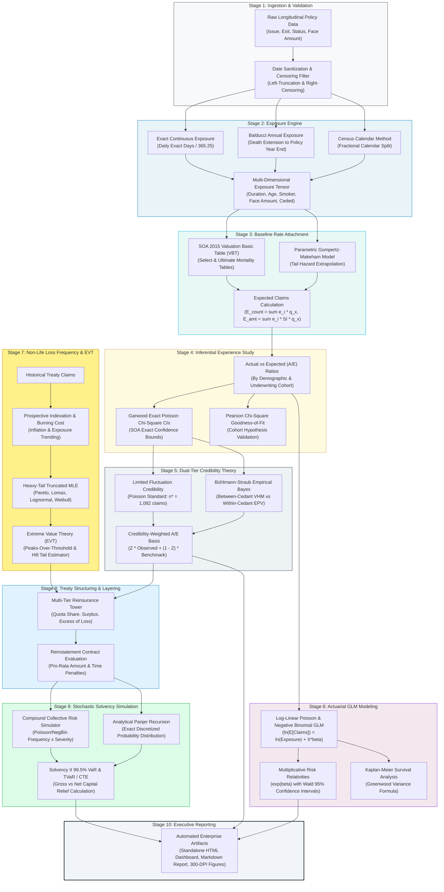

# 🔄 End-to-End Quantitative Process & Actuarial Workflow

This document provides a comprehensive, step-by-step technical breakdown of the reinsurance experience study and risk analysis pipeline implemented in `reinsurance-analytics`.

---

## 🗺️ Operational & Mathematical Workflow Overview

The system transitions raw, longitudinal policyholder and treaty loss records into fully audited, credibility-weighted pricing bases, stochastic capital metrics, and executive artifacts:



---

## 📋 Detailed Phase Breakdown

### Phase 1: Longitudinal Data Ingestion & Sanitization

Actuarial experience datasets are inherently longitudinal, right-censored, and subject to left-truncation. Every record represents an individual policyholder or treaty participation tracked across calendar intervals.

1. **Censoring Detection:**
   - Active policies at study termination date $T_{\text{end}}$ are classified as right-censored.
   - Voluntary surrenders/lapses are marked as right-censored at exit date $T_{\text{exit}}$.
   - Mortality events are tagged as uncensored terminal events at exit date $T_{\text{exit}}$.
2. **Boundary Truncation:**
   - Policies issued prior to study inception ($T_{\text{issue}} < T_{\text{start}}$) enter the exposure window at $T_{\text{start}}$ (left-truncation).
   - Policies exiting prior to $T_{\text{start}}$ or issued after $T_{\text{end}}$ are filtered out automatically with zero exposure credit.
3. **Audit Invariant Checks:**
   - Validates $T_{\text{issue}} \le T_{\text{exit}}$.
   - Asserts non-negative sum insured / face amounts.
   - Normalizes demographic keys (`gender`, `smoker_status`, `underwriting_tier`, `attained_age`).

---

### Phase 2: Exact Exposure Engines

A major source of bias in actuarial studies arises from crude exposure approximations. `reinsurance-analytics` provides three distinct exposure engines:

#### 1. Exact Continuous (Daily Fractional) Exposure
Measures the precise physical fraction of a year that the policyholder was exposed to the hazard:
$$e_i = \frac{\max\left(0, \min(T_{\text{end}}, T_{\text{exit}}) - \max(T_{\text{start}}, T_{\text{issue}})\right)}{365.25}$$

#### 2. Classical Balducci Hypothesis (Annual Exposure)
In life contingency mathematics, the Balducci assumption posits that for individuals who die within policy year $t$, their exposure is credited through the end of that entire policy year:
$$e_i^{\text{Balducci}} = \begin{cases} 
e_i + (1 - f_i), & \text{if policyholder died in policy year} \\
e_i, & \text{otherwise}
\end{cases}$$
where $f_i$ is the elapsed fraction of the policy year prior to death.

#### 3. Census Calendar Year Method
Splits policy lifetimes into distinct calendar year segments to align directly with regulatory reporting, accounting books, and statutory valuation schedules.

**Multi-Dimensional Exposure Metrics:**
- **Count Exposure:** Pure life-years of survival exposure.
- **Face Amount Exposure:** Life-years weighted by gross sum insured ($e_i \cdot \text{SI}_i$).
- **Ceded Exposure:** Net reinsurance exposure ceded under treaty structures ($e_i \cdot \text{Ceded\_SI}_i$).

---

### Phase 3: Actuarial Baseline Attachment

To evaluate whether experience is favorable or adverse, actual claims must be contrasted against an authoritative expected basis:

1. **SOA 2015 Valuation Basic Table (VBT):**
   - Incorporates select-and-ultimate mortality structures.
   - Durations 1 to 25 reflect select underwriting factors where recent underwriting produces lower mortality rates.
   - Attained ages 70+ transition into ultimate mortality convergence.
2. **Parametric Gompertz-Makeham Extrapolation:**
   - For extreme ages (age > 95) or customized international blocks, the hazard follows:
     $$\mu(x) = A + B \cdot c^x$$
   - Under constant force of mortality, the annual probability of death is:
     $$q_x = 1 - \exp\left( - \int_x^{x+1} \mu(t) dt \right) = 1 - \exp\left( -A - \frac{B}{\ln c} c^x (c - 1) \right)$$
3. **Expected Claims Synthesis:**
   - Expected claim counts: $E_{\text{count}} = \sum_{i=1}^n e_i \cdot q_{x_i}^{\text{benchmark}}$
   - Expected claim amounts: $E_{\text{amount}} = \sum_{i=1}^n e_i \cdot \text{SI}_i \cdot q_{x_i}^{\text{benchmark}}$

---

### Phase 4: Inferential Experience Study & Exact Poisson Intervals

Rather than reporting naive point estimates, the engine evaluates statistical significance across demographic cohorts:

1. **Actual-to-Expected ($A/E$) Ratios:**
   $$\text{A/E}_{\text{count}} = \frac{\sum A_i}{\sum E_i}, \quad \text{A/E}_{\text{amount}} = \frac{\sum A_i \cdot \text{SI}_i}{\sum E_i \cdot \text{SI}_i}$$
2. **Garwood Exact Poisson Confidence Intervals:**
   Traditional asymptotic normal bounds ($A/E \pm 1.96 \sqrt{A}/E$) break down when claim counts are low (e.g., $A < 30$), yielding negative lower bounds or underestimating upper tail volatility. The engine implements the exact Garwood Chi-Square relationship adopted by the Society of Actuaries:
   $$\text{CI}_{1-\alpha} = \left[ \frac{\chi^2_{2A, \, \alpha/2}}{2E}, \; \frac{\chi^2_{2(A+1), \, 1 - \alpha/2}}{2E} \right]$$
   For cells with zero observed claims ($A = 0$):
   $$\text{CI}_{1-\alpha} = \left[ 0, \; \frac{\chi^2_{2, \, 1 - \alpha}}{2E} \right]$$
3. **Pearson $\chi^2$ Goodness-of-Fit Test:**
   Tests the hypothesis that observed deviations across all demographic cohorts are purely random Poisson fluctuations:
   $$\chi^2_{\text{stat}} = \sum_{j=1}^K \frac{(A_j - E_j)^2}{E_j}, \quad p = 1 - F_{\chi^2_{K-1}}(\chi^2_{\text{stat}})$$

---

### Phase 5: Dual-Tier Credibility Theory

Reinsurance portfolios frequently contain sparse cohorts where observed experience cannot be fully trusted. The platform implements two complementary credibility frameworks:

#### 1. Classical / Limited Fluctuation Credibility
Determines the volume of exposure needed for observed data to be within a margin $k$ (typically 5%) of the true mean with probability $p = 1 - \alpha$ (typically 90%):
$$n^* = \left(\frac{z_{1 - \alpha/2}}{k}\right)^2 (1 + CV^2)$$
For Poisson claims ($CV = 0$) at $p = 90\%, k = 5\%$:
$$n^* = \left(\frac{1.64485}{0.05}\right)^2 \approx 1,082.41 \text{ claims}$$
Partial credibility factor $Z \in [0, 1]$:
$$Z = \min\left(1.0, \sqrt{\frac{n}{n^*}}\right)$$
Credibility-adjusted mortality expectation:
$$\text{A/E}_{\text{cred}} = Z \cdot (\text{A/E}) + (1 - Z) \cdot 1.00$$

#### 2. Bühlmann-Straub Nonparametric Empirical Bayes Credibility
When modeling multi-cedant reinsurance treaties, the platform estimates between-cedant heterogeneity versus within-cedant process variance:
- **Expected Value of Process Variance (EPV / $s^2$):** Within-cedant volatility over time.
- **Variance of Hypothetical Means (VHM / $a$):** True cross-cedant risk divergence.
- **Bühlmann Parameter ($k^*$):**
  $$k^* = \frac{s^2}{a}$$
- **Cedant-Specific Credibility Factor ($Z_i$):**
  $$Z_i = \frac{P_{i\cdot}}{P_{i\cdot} + k^*}$$
This objectively prevents small or noisy cedants from polluting the collective pricing basis while allowing large portfolios to establish their own autonomous rates.

---

### Phase 6: Actuarial Generalized Linear Models (GLMs)

To control for confounding variables across age, duration, smoking status, and underwriting tier, the platform fits a Poisson GLM with a canonical logarithmic link and an exact $\ln(\text{Exposure})$ offset:

$$\ln(\mathbb{E}[\text{Claims}_i]) = \ln(\text{Exposure}_i) + \beta_0 + \sum_{j=1}^p \beta_j X_{ij}$$

1. **Multiplicative Relativities:**
   The impact of each risk characteristic is expressed as a multiplicative multiplier relative to the baseline class:
   $$\text{Relativity}_j = \exp(\beta_j)$$
2. **Wald Confidence Intervals:**
   $$\text{CI}_{95\%}(\text{Relativity}_j) = \left[ \exp\left(\hat{\beta}_j - 1.96 \cdot \text{SE}(\hat{\beta}_j)\right), \; \exp\left(\hat{\beta}_j + 1.96 \cdot \text{SE}(\hat{\beta}_j)\right) \right]$$
3. **Kaplan-Meier Survival Estimation:**
   Nonparametric survival analysis evaluating policy lapse and persistence curves using **Greenwood's variance formula**:
   $$\hat{S}(t) = \prod_{t_i \le t} \left(1 - \frac{d_i}{n_i}\right), \quad \widehat{\text{Var}}(\hat{S}(t)) = \hat{S}(t)^2 \sum_{t_i \le t} \frac{d_i}{n_i (n_i - d_i)}$$

---

### Phase 7: Non-Life Loss Frequency, Severity & EVT

For casualty, property, and catastrophe reinsurance treaties:

1. **Prospective Loss Indexation & Burning Cost:**
   Historical losses are trended to current cost levels using inflation and exposure adjustment indices:
   $$\tilde{X}_t = X_t \cdot \prod_{s=t}^{T} (1 + j_s) \cdot \frac{\text{Exposure}_T}{\text{Exposure}_t}$$
2. **Truncated Heavy-Tail MLE:**
   Loss severity above treaty attachment points is fitted to candidate distributions:
   - **Pareto Type I:** $f(x) = \frac{\alpha x_m^\alpha}{x^{\alpha+1}}$
   - **Lomax (Pareto Type II):** $f(x) = \frac{\alpha}{\lambda} \left(1 + \frac{x}{\lambda}\right)^{-(\alpha+1)}$
   - **Lognormal & Weibull**
3. **Limited Expected Value (LEV):**
   Calculates expected layer cost:
   $$\mathbb{E}[X \wedge u] = \int_0^u (1 - F(x)) dx$$
4. **Extreme Value Theory (EVT) - Peaks-Over-Threshold (POT):**
   For threshold $u$, excess losses $Y = X - u$ follow a Generalized Pareto Distribution (GPD):
   $$F_u(y) = 1 - \left(1 + \frac{\xi y}{\sigma}\right)^{-1/\xi}$$
   The heavy-tail index $\xi > 0$ determines the extreme tail risk, estimated via Maximum Likelihood and verified using the **Hill Estimator**:
   $$\hat{\alpha}_{\text{Hill}} = \left( \frac{1}{k} \sum_{i=1}^k \ln\left(\frac{X_{(n-i+1)}}{X_{(n-k)}}\right) \right)^{-1}$$

---

### Phase 8: Reinsurance Treaty Structuring & Layering

Treaties are modeled as discrete contractual transformations applied to simulated or historical loss vectors:

```
Gross Loss X
     │
     ├──► [Quota Share Cession: c * X] ─────────────► Ceded Loss (QS)
     │
     ├──► [Surplus Line Retention: min(n*R, X - R)] ─► Ceded Loss (Surplus)
     │
     └──► [Working XL: Limit L1 xs Attachment A1] ───► Ceded Loss (Layer 1)
               │
               └──► [Cat XL: Limit L2 xs Att A2] ────► Ceded Loss (Layer 2)
                         │
                         └──► Net Retained by Cedant
```

1. **Quota Share:** Cession ratio $c$, ceding commission $c_{\text{comm}}$, and sliding-scale profit commission.
2. **Surplus:** Retention line $R$, maximum ceded lines $n$.
3. **Excess of Loss (Per Risk / Per Occurrence):** $L \text{ xs } A$.
4. **Reinstatement Premium Calculations:**
   - **Pro-Rata as to Amount:**
     $$\Pi_{\text{reinst}} = \frac{\text{Loss Ceded}}{L} \times \text{Rate} \times \text{Initial Premium}$$
   - **Pro-Rata as to Time and Amount:**
     $$\Pi_{\text{reinst}} = \frac{\text{Loss Ceded}}{L} \times \frac{T_{\text{remaining}}}{365.25} \times \text{Rate} \times \text{Initial Premium}$$

---

### Phase 9: Stochastic Collective Risk Simulation & Panjer Recursion

Aggregate annual portfolio losses are modeled as a compound collective risk process:

$$S = \sum_{i=1}^N X_i, \quad N \sim \text{Poisson}(\lambda) \text{ or } \text{NegBin}(r, p), \quad X_i \sim F_X$$

1. **Vectorized Monte Carlo Engine:**
   - Simulates 10,000+ portfolio annual realizations.
   - For each realization, draws claim frequency $N$, samples individual claim sizes $X_1, \dots, X_N$ from calibrated severity distributions, and passes them through the multi-tier treaty layer cascade.
2. **Analytical Panjer Recursion Algorithm:**
   - Computes exact discretized probability mass function $g_k = \mathbb{P}(S = k)$ without sampling variance:
     $$g_k = \frac{1}{1 - a f_0} \sum_{j=1}^k \left(a + \frac{b j}{k}\right) f_j g_{k-j}$$
3. **Solvency Capital Requirement (SCR) Relief:**
   - Evaluates Value-at-Risk ($\text{VaR}_{99.5\%}$) and Tail Value-at-Risk ($\text{TVaR}_{99.5\%}$ / Expected Shortfall):
     $$\text{VaR}_\alpha(S) = \inf\{s : F_S(s) \ge \alpha\}$$
     $$\text{TVaR}_\alpha(S) = \frac{1}{1 - \alpha} \int_\alpha^1 \text{VaR}_u(S) du$$
   - Under Solvency II regulations, Underwriting Risk Capital is dictated by the 1-in-200 year event ($\text{VaR}_{99.5\%} - \mathbb{E}[S]$):
     $$\text{SCR Relief} = \text{SCR}_{\text{Gross}} - \text{SCR}_{\text{Net}}$$

---

### Phase 10: Automated Enterprise Reporting & Artifact Generation

In the final phase, all quantitative findings are formatted into executive artifacts:
- **Publication-Quality Figures:** Generated at 300 DPI (`matplotlib`) with high-contrast color palettes and error bands.
- **Self-Contained Executive HTML Dashboard:** Responsive, standalone HTML report with tables, summary metric cards, and underwriting recommendations.
- **GitHub Flavored Markdown Report:** Fully styled for instant rendering in version control repositories, PR reviews, and regulatory audits.

---

## 🏛️ Governance, Auditability & Model Risk Management (SR 11-7)

Every run produced by this pipeline adheres to Model Risk Management guidelines (SR 11-7 / Solvency II Internal Model Validation):
1. **Deterministic Reproducibility:** Every stochastic step accepts an explicit PRNG seed (`seed=42`).
2. **Immutability:** Input raw data is never mutated; all transformations generate clean derived data structures.
3. **Formula Transparency:** Zero black-box compiled binaries; every actuarial formula is openly defined in typed Python dataclasses.

---

## 🧭 Related Documentation
- ⚡ [**Technologies Used & Market Practice Comparison**](technologies_used.md)
- 📊 [**Empirical Results & Solvency Case Studies**](results.md)
- 📐 [**Actuarial Methodology & Mathematical Foundations**](actuarial_methodology.md)
- 🏗️ [**Reinsurance Treaty Structures**](treaty_structures.md)
- 🏠 [**Project Main Page (README)**](../README.md)
